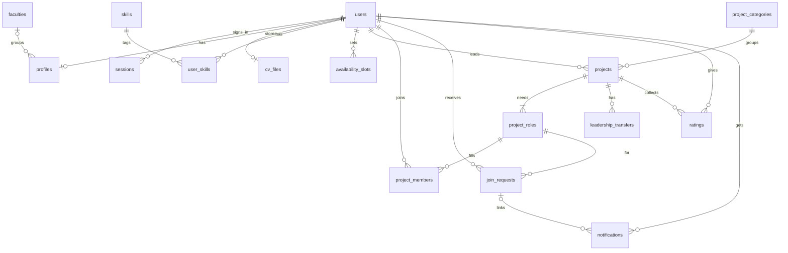

# Database Schema

PostgreSQL schema for the first release (PostgreSQL 17 in containers, PostgreSQL 16 supported locally), based on the Linear acceptance criteria and the wireframe (v0.1). When they disagree, the acceptance criteria win and the conflict is listed under [Open questions](#open-questions).

## Conventions

- Primary keys are `uuid` with `gen_random_uuid()`, unless a table says otherwise.
- Timestamps are `timestamptz`. `created_at` defaults to `now()`.
- `updated_at` is set whenever a row changes.
- History is kept by marking rows (`left_at`, `removed_at`, `deleted_at`, `closed_at`), not by deleting them.
- A team and its project are one row in `projects`. "Team" and "project" in the tickets both point to it.

## Diagram

## Enums

| Enum                    | Values                                                                                                                                          |
| ----------------------- | ----------------------------------------------------------------------------------------------------------------------------------------------- |
| `project_status`        | `not_started`, `in_progress`, `completed`, `cancelled`                                                                                          |
| `recruitment_status`    | `open`, `closed`                                                                                                                                |
| `duration_unit`         | `day`, `week`, `month`                                                                                                                          |
| `member_left_reason`    | `left`, `removed`, `team_deleted`, `account_closed`                                                                                             |
| `request_type`          | `application`, `invitation`                                                                                                                     |
| `request_status`        | `pending`, `approved`, `rejected`, `accepted`, `declined`, `withdrawn`, `cancelled`, `expired`                                                  |
| `request_cancel_reason` | `lead_cancelled`, `role_removed`, `role_full`, `recruitment_closed`, `project_completed`, `project_cancelled`, `team_deleted`, `account_closed` |
| `transfer_status`       | `pending`, `accepted`, `declined`, `cancelled`                                                                                                  |

## Accounts

### `users`

Stories: ACCT-01, ACCT-02, ACCT-04. The identity model reserves `oauth_subject` for Chula OAuth, which is deferred. The MVP uses `demo:<email>` only while `DEMO_SIGN_IN=true`. There is no password column or email-code table.

| Column              | Type          | Rules                                                              |
| ------------------- | ------------- | ------------------------------------------------------------------ |
| `id`                | `uuid`        | Primary key                                                        |
| `email`             | `text`        | Not null, unique, lowercase, must end in `@student.chula.ac.th`    |
| `oauth_subject`     | `text`        | Not null, unique. The stable ID Chula OAuth gives for this student |
| `created_at`        | `timestamptz` | Not null                                                           |
| `updated_at`        | `timestamptz` | Not null                                                           |
| `last_signed_in_at` | `timestamptz` |                                                                    |
| `closed_at`         | `timestamptz` | Set when the account is closed                                     |

### `sessions`

Stories: ACCT-01, ACCT-02. Signing in adds a row. Signing out or closing the account sets `revoked_at`.

| Column       | Type          | Rules                                         |
| ------------ | ------------- | --------------------------------------------- |
| `id`         | `uuid`        | Primary key                                   |
| `user_id`    | `uuid`        | Not null, references `users`                  |
| `token_hash` | `text`        | Not null, unique. Never store the plain token |
| `created_at` | `timestamptz` | Not null                                      |
| `expires_at` | `timestamptz` | Not null                                      |
| `revoked_at` | `timestamptz` |                                               |

Index on `user_id` where `revoked_at` is null. Sessions use random 32-byte tokens in an HttpOnly, SameSite=Lax cookie. Only the SHA-256 token hash is stored; sign-out and account closure revoke sessions.

## Profiles

### `faculties`

Stories: PROF-01.

| Column       | Type          | Rules            |
| ------------ | ------------- | ---------------- |
| `id`         | `uuid`        | Primary key      |
| `name`       | `text`        | Not null, unique |
| `created_at` | `timestamptz` | Not null         |

The starter migration includes these faculties and schools:

- Faculty of Allied Health Sciences
- Faculty of Architecture
- Faculty of Arts
- Faculty of Commerce and Accountancy
- Faculty of Communication Arts
- Faculty of Dentistry
- Faculty of Economics
- Faculty of Education
- Faculty of Engineering
- Faculty of Fine and Applied Arts
- Faculty of Integrated Agriculture
- Faculty of Law
- Faculty of Medicine
- Faculty of Nursing
- Faculty of Pharmaceutical Sciences
- Faculty of Political Science
- Faculty of Psychology
- Faculty of Science
- Faculty of Sports Science
- Faculty of Veterinary Science
- School of Integrated Innovation

### `profiles`

Stories: PROF-01 to PROF-04, DISC-08. Created at profile setup, so every field except the key can start empty.

| Column           | Type          | Rules                                    |
| ---------------- | ------------- | ---------------------------------------- |
| `user_id`        | `uuid`        | Primary key, references `users`          |
| `display_name`   | `text`        |                                          |
| `faculty_id`     | `uuid`        | References `faculties`                   |
| `year`           | `smallint`    | From 1 to 8                              |
| `headline`       | `text`        |                                          |
| `working_style`  | `text`        |                                          |
| `cv_storage_key` | `text`        | `db:<user_id>` for the PDF in `cv_files` |
| `cv_file_name`   | `text`        |                                          |
| `cv_size_bytes`  | `integer`     | From 1 to 5242880 (5 MB)                 |
| `cv_uploaded_at` | `timestamptz` |                                          |
| `cv_shared`      | `boolean`     | Not null, default `false`                |
| `created_at`     | `timestamptz` | Not null                                 |
| `updated_at`     | `timestamptz` | Not null                                 |

- The four `cv_*` file columns are either all set or all null.
- A profile is searchable when it has `display_name`, `faculty_id` and at least one row in `user_skills`, and the user is not closed. This is calculated, not stored.
- Check `cv_shared` on every CV request, so turning it off also blocks old platform links.

### `cv_files`

Stories: PROF-03, PROF-04. PDF bytes live in PostgreSQL because the hosting filesystem is ephemeral. Upload, replace, and delete update these bytes and the profile metadata in one transaction.

| Column    | Type    | Rules                           |
| --------- | ------- | ------------------------------- |
| `user_id` | `uuid`  | Primary key, references `users` |
| `content` | `bytea` | Not null, PDF contents          |

There is no public storage URL. `GET /users/{id}/cv` checks the session, the account status, and the current `cv_shared` permission on every request; the owner may always read their own CV.

### `skills`

Stories: PROF-01, DISC-05.

| Column            | Type          | Rules                                                       |
| ----------------- | ------------- | ----------------------------------------------------------- |
| `id`              | `uuid`        | Primary key                                                 |
| `name`            | `text`        | Not null                                                    |
| `normalized_name` | `text`        | Generated as `lower(trim(name))`, unique                    |
| `is_predefined`   | `boolean`     | Not null, default `false`. `false` means a student added it |
| `created_at`      | `timestamptz` | Not null                                                    |

### `user_skills`

Stories: PROF-01, DISC-05. Primary key is `(user_id, skill_id)`, with an index on `skill_id`.

| Column       | Type          | Rules               |
| ------------ | ------------- | ------------------- |
| `user_id`    | `uuid`        | References `users`  |
| `skill_id`   | `uuid`        | References `skills` |
| `created_at` | `timestamptz` | Not null            |

### `availability_slots`

Stories: PROF-05. Primary key is `(user_id, day_of_week, start_time)`. No rows means Not specified.

| Column        | Type          | Rules                                |
| ------------- | ------------- | ------------------------------------ |
| `user_id`     | `uuid`        | References `users`                   |
| `day_of_week` | `smallint`    | From 1 (Monday) to 7 (Sunday)        |
| `start_time`  | `time`        | Bangkok time, on `:00` or `:30` only |
| `created_at`  | `timestamptz` | Not null                             |

## Projects and teams

### `project_categories`

Stories: DISC-01, DISC-06. First values from the wireframe: Hackathon/Case competition, Startup, SME, Side project, Others.

| Column       | Type          | Rules            |
| ------------ | ------------- | ---------------- |
| `id`         | `uuid`        | Primary key      |
| `name`       | `text`        | Not null, unique |
| `created_at` | `timestamptz` | Not null         |

### `projects`

Stories: DISC-01, DISC-02, DISC-04, DISC-06, DISC-07, LIFE-01 to LIFE-05, TEAM-03 to TEAM-05.

| Column                    | Type                 | Rules                                                                |
| ------------------------- | -------------------- | -------------------------------------------------------------------- |
| `id`                      | `uuid`               | Primary key                                                          |
| `name`                    | `text`               | Not null                                                             |
| `description`             | `text`               | Not null                                                             |
| `category_id`             | `uuid`               | Not null, references `project_categories`                            |
| `lead_user_id`            | `uuid`               | Not null, references `users`. One column, so always exactly one lead |
| `status`                  | `project_status`     | Not null, default `not_started`                                      |
| `recruitment_status`      | `recruitment_status` | Not null, default `open`                                             |
| `expected_duration_value` | `integer`            | Not null, above 0                                                    |
| `expected_duration_unit`  | `duration_unit`      | Not null                                                             |
| `expected_end_date`       | `date`               | Required once started                                                |
| `line_url`                | `text`               | Must start with `https://`                                           |
| `discord_url`             | `text`               | Must start with `https://`                                           |
| `created_at`              | `timestamptz`        | Not null                                                             |
| `updated_at`              | `timestamptz`        | Not null                                                             |
| `started_at`              | `timestamptz`        | Null only while `not_started`                                        |
| `completed_at`            | `timestamptz`        | Set only when `completed`                                            |
| `cancelled_at`            | `timestamptz`        | Set only when `cancelled`                                            |
| `deleted_at`              | `timestamptz`        | Only for a team that never started. Hide these from search           |
| `end_reminder_sent_at`    | `timestamptz`        | Stops repeat reminders. Clear it when the end date is extended       |

- A `completed` or `cancelled` project must have recruitment `closed`.
- Index on `category_id` where recruitment is `open` and `deleted_at` is null for browsing, and on `lead_user_id`.
- The rating window closes at `completed_at` plus 14 days. This is calculated, not stored.

### `project_roles`

Stories: DISC-01 to DISC-03.

| Column       | Type          | Rules                                                                |
| ------------ | ------------- | -------------------------------------------------------------------- |
| `id`         | `uuid`        | Primary key, also unique with `project_id`                           |
| `project_id` | `uuid`        | Not null, references `projects`                                      |
| `name`       | `text`        | Not null, unique per project (ignoring case) among roles not removed |
| `capacity`   | `integer`     | Not null, at least 1                                                 |
| `created_at` | `timestamptz` | Not null                                                             |
| `updated_at` | `timestamptz` | Not null                                                             |
| `removed_at` | `timestamptz` | Keeps the role name in member history                                |

### `project_members`

Stories: DISC-01, APPL-03, APPL-05, TEAM-01, TEAM-02, RATE-01. Leaving ends the row, and joining again adds a new one.

| Column        | Type                 | Rules                                                                                                |
| ------------- | -------------------- | ---------------------------------------------------------------------------------------------------- |
| `id`          | `uuid`               | Primary key                                                                                          |
| `project_id`  | `uuid`               | Not null                                                                                             |
| `role_id`     | `uuid`               | Not null. `(role_id, project_id)` references `project_roles`, so the role must belong to the project |
| `user_id`     | `uuid`               | Not null, references `users`                                                                         |
| `joined_at`   | `timestamptz`        | Not null                                                                                             |
| `updated_at`  | `timestamptz`        | Not null                                                                                             |
| `left_at`     | `timestamptz`        | Null while a current member                                                                          |
| `left_reason` | `member_left_reason` | Set together with `left_at`                                                                          |

- Partial unique index on `(project_id, user_id)` where `left_at` is null: one current membership per team.
- Available places in a role are `capacity` minus its members where `left_at` is null.
- Index on `role_id` where `left_at` is null, and on `user_id`.

### `leadership_transfers`

Stories: TEAM-03.

| Column         | Type              | Rules                                                       |
| -------------- | ----------------- | ----------------------------------------------------------- |
| `id`           | `uuid`            | Primary key                                                 |
| `project_id`   | `uuid`            | Not null, references `projects`                             |
| `from_user_id` | `uuid`            | Not null, references `users`                                |
| `to_user_id`   | `uuid`            | Not null, references `users`, different from `from_user_id` |
| `status`       | `transfer_status` | Not null, default `pending`                                 |
| `created_at`   | `timestamptz`     | Not null                                                    |
| `updated_at`   | `timestamptz`     | Not null                                                    |
| `resolved_at`  | `timestamptz`     | Null only while `pending`                                   |

Partial unique index on `project_id` where `status` is `pending`: one pending transfer per team.

## Recruitment

### `join_requests`

Stories: APPL-01 to APPL-06. Applications and invitations share this table because the tickets apply the same rules to both.

| Column          | Type                    | Rules                                                                      |
| --------------- | ----------------------- | -------------------------------------------------------------------------- |
| `id`            | `uuid`                  | Primary key                                                                |
| `type`          | `request_type`          | Not null                                                                   |
| `project_id`    | `uuid`                  | Not null                                                                   |
| `role_id`       | `uuid`                  | Not null. `(role_id, project_id)` references `project_roles`               |
| `student_id`    | `uuid`                  | Not null, references `users`. The student applying or being invited        |
| `invited_by_id` | `uuid`                  | References `users`. Set only for invitations                               |
| `message`       | `text`                  | Applications only, optional                                                |
| `status`        | `request_status`        | Not null, default `pending`                                                |
| `cancel_reason` | `request_cancel_reason` | Set only when `cancelled`                                                  |
| `created_at`    | `timestamptz`           | Not null                                                                   |
| `updated_at`    | `timestamptz`           | Not null                                                                   |
| `expires_at`    | `timestamptz`           | Not null, default 48 hours after creation                                  |
| `resolved_at`   | `timestamptz`           | Null only while `pending`. Also set when a request expires or is cancelled |

- Applications can end as `approved`, `rejected`, `withdrawn`, `cancelled` or `expired`.
- Invitations can end as `accepted`, `declined`, `cancelled` or `expired`.
- Partial unique index on `(project_id, student_id)` where `status` is `pending`: one pending request per student per team, across both types.
- Index on `(project_id, student_id, created_at DESC)` for the retry rule, on `(student_id, created_at DESC)` for My requests, and on `expires_at` where `pending` for expiry.

## Ratings

### `ratings`

Stories: RATE-02 to RATE-06. Unique on `(project_id, reviewer_id, recipient_id)`, so editing replaces the score. Index on `recipient_id` for profile averages.

| Column         | Type          | Rules                                                      |
| -------------- | ------------- | ---------------------------------------------------------- |
| `id`           | `uuid`        | Primary key                                                |
| `project_id`   | `uuid`        | Not null, references `projects`                            |
| `reviewer_id`  | `uuid`        | Not null, references `users`                               |
| `recipient_id` | `uuid`        | Not null, references `users`, different from `reviewer_id` |
| `score`        | `smallint`    | Not null, from 1 to 5                                      |
| `created_at`   | `timestamptz` | Not null                                                   |
| `updated_at`   | `timestamptz` | Not null                                                   |

- Eligible people are the members of a completed project with `left_at` null. Membership is frozen at completion, so no separate list is needed.
- A rating is published once its window has closed. This is calculated from `completed_at`, so no publish flag or job is needed.

## Notifications

### `notifications`

Stories: NOTI-01, NOTI-02, and every story that notifies someone. In-app only.

| Column            | Type          | Rules                                                |
| ----------------- | ------------- | ---------------------------------------------------- |
| `id`              | `uuid`        | Primary key                                          |
| `user_id`         | `uuid`        | Not null, references `users`                         |
| `type`            | `text`        | Not null, like `request_expired`                     |
| `project_id`      | `uuid`        | References `projects`, for the link                  |
| `join_request_id` | `uuid`        | References `join_requests`, for the link             |
| `data`            | `jsonb`       | Not null, default `{}`. Extra values for the message |
| `created_at`      | `timestamptz` | Not null                                             |
| `read_at`         | `timestamptz` | Null means unread                                    |

Indexes: `(user_id, created_at DESC)` for the inbox, and `user_id` where `read_at` is null for the unread count.

## Rules the app must enforce

The database cannot check these on its own, so the Go API does.

- **Sign-in:** demo sign-in is explicitly gated by `DEMO_SIGN_IN=true` and uses `demo:<email>`. Chula OAuth is not implemented. Do not enable demo sign-in for real student data.
- **Filling a place:** when approving or accepting, lock the `project_roles` row, check a place is free, then add the member and update the request in one transaction. This stops two people taking the last place.
- **Retry rule:** read the latest request for that student and team. If it is a `rejected` application, the student cannot apply until the lead invites them. If it is a `declined` invitation, the lead cannot invite until the student applies. Any other outcome allows a new request.
- **Expiry:** a `pending` request past `expires_at` is expired. Set it to `expired` and notify both sides when a request is next read or before a new one is created, otherwise the unique index blocks the new one. Do not rely on a timer inside the API, because free Render services sleep after 15 minutes without traffic. The same applies to the end-date reminder.
- **Role becomes full:** set the other pending requests for that role to `cancelled` with reason `role_full`, then notify those students. They can apply again if a place opens.
- **Capacity:** reject lowering `capacity` below the current member count.
- **Removing a role:** reject it while the role has current members.
- **Lead:** `lead_user_id` must be a current member. Create the project, its roles and the lead's membership in one transaction.
- **Contact links:** parse HTTPS URLs and reject credentials, lookalike hosts, and unsupported ports. LINE accepts `line.me` and its subdomains; Discord accepts `discord.gg` invite paths or `discord.com/invite/...`. Only current members can read them, including immediately after a leave or removal.
- **Lifecycle:** starting requires closed recruitment. Deletion requires `not_started` and closes recruitment in the deletion transaction. Completion and cancellation close recruitment and cancel pending requests. Freeing a place never reopens closed recruitment.
- **Frozen membership:** completion and cancellation prevent leave, removal, recruitment edits, and leadership changes. Account closure preserves terminal membership rows while hiding the closed account and its ratings.
- **Transfers:** the recipient must be a different current member with an open account. One transfer may be pending; only acceptance changes the single lead. Leaving, removal, account closure, completion, cancellation, and deletion cancel affected pending transfers.
- **Ratings:** the only publication boundary is `completed_at + 14 days`. Reviewer and recipient must be different current members with open accounts. Frozen memberships fix eligible participants at completion. Upserts replace one score per pair and project. During the window a participant can see only scores they gave; all others remain hidden. Only published scores contribute to averages, and missing submissions never count as zero.

## Build order

| When                      | Tables                                                                                                 |
| ------------------------- | ------------------------------------------------------------------------------------------------------ |
| Sprint 1                  | `users`, `sessions`, `faculties`, `profiles`, `skills`, `user_skills`                                  |
| Next, profile extras      | `availability_slots`, `cv_files`                                                                       |
| Next, posting and joining | `project_categories`, `projects`, `project_roles`, `project_members`, `join_requests`, `notifications` |
| After that                | `leadership_transfers`, `ratings`                                                                      |

## Starter data

The `00002_starter_lists.sql` migration adds faculties, project categories, and predefined skills, including the School of Integrated Innovation. Demo students and scenario data are added separately by `cmd/seed`. The backlog has no admin stories, so changing lookup lists takes a migration.

## Tooling

Use [pgx](https://github.com/jackc/pgx) as the driver and [goose](https://github.com/pressly/goose) for migrations, written as plain SQL files.

## Open questions

For the team to confirm. The schema uses the choice shown until then.

| Topic                  | Conflict                                                                                                                            | Schema for now                                                              |
| ---------------------- | ----------------------------------------------------------------------------------------------------------------------------------- | --------------------------------------------------------------------------- |
| Sign-in method         | ACCT-01, ACCT-02, the project scope and wireframe S01, S02 describe a 6-digit email code, but the team decided on Chula OAuth       | OAuth, no code table. The tickets and wireframe need updating               |
| Passwords              | Chula OAuth means no passwords, but ACCT-03 "Reset a forgotten password" exists with empty criteria                                 | No password column. ACCT-03 may be dropped                                  |
| Closing an account     | ACCT-04 is empty and ACCT-05 is only in the wireframe, so erasing an account and its effect on other people's ratings are undefined | `closed_at` only, no erase flow yet                                         |
| Email notifications    | The project scope lists email, but NOTI-01 and NOTI-02 defer it                                                                     | In-app only                                                                 |
| Role full wording      | Wireframe S08 shows these requests as Rejected                                                                                      | `cancelled` with `role_full`. S08 needs updating                            |
| Faculty list           | The wireframe mixes faculties and programs (BAScii, Eng CP, Eng CEDT)                                                               | Lookup table seeded by migration, including School of Integrated Innovation |
| Category list          | The wireframe says the list is not final                                                                                            | Lookup table with the first values above                                    |
| Working style          | The format is undecided (free text or MBTI/style picker)                                                                            | Optional text                                                               |
| Availability           | PROF-05 uses 30-minute slots, the flow mentions Google Calendar                                                                     | 30-minute slots                                                             |
| Rating details         | The flow has tags and comments, the tickets only have scores                                                                        | Score only                                                                  |
| Apply message          | In the wireframe, not in APPL-01                                                                                                    | Optional column                                                             |
| Contact links          | TEAM-05 says a link, the wireframe allows both LINE and Discord                                                                     | One column for each                                                         |
| Link required to start | The wireframe requires it, LIFE-01 does not                                                                                         | Not required                                                                |
| Limits of 3            | Wireframe notes cap pending applications and projects at 3, the tickets do not                                                      | No database rule                                                            |
| Skills on roles        | S05 shows skills on a role, but S10 has no way to enter them                                                                        | Left out                                                                    |
| CV file storage        | PROF-03 needs somewhere to keep PDFs, and the infra only has the web services and PostgreSQL                                        | `cv_files.content` in PostgreSQL; `cv_storage_key` is `db:<user_id>`        |
